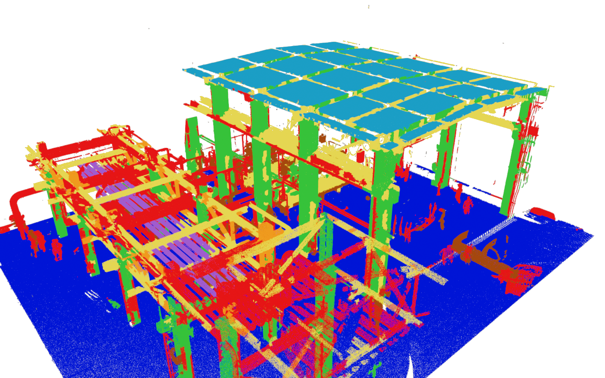

# Segmentación de una nube de puntos industrial mediante clustering

Segmenta `FARO_Scan_Full_Sub1_down3_with_normals.ply` en ocho clases.



## Uso

```bash
python -m venv .venv && source .venv/bin/activate
pip install -r requirements.txt
jupyter nbconvert --to notebook --execute --inplace pipeline.ipynb
```

La nube de entrada va en `data/`. El resultado es `output/segmentacion_final.ply`.
